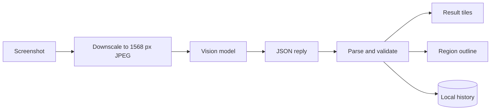
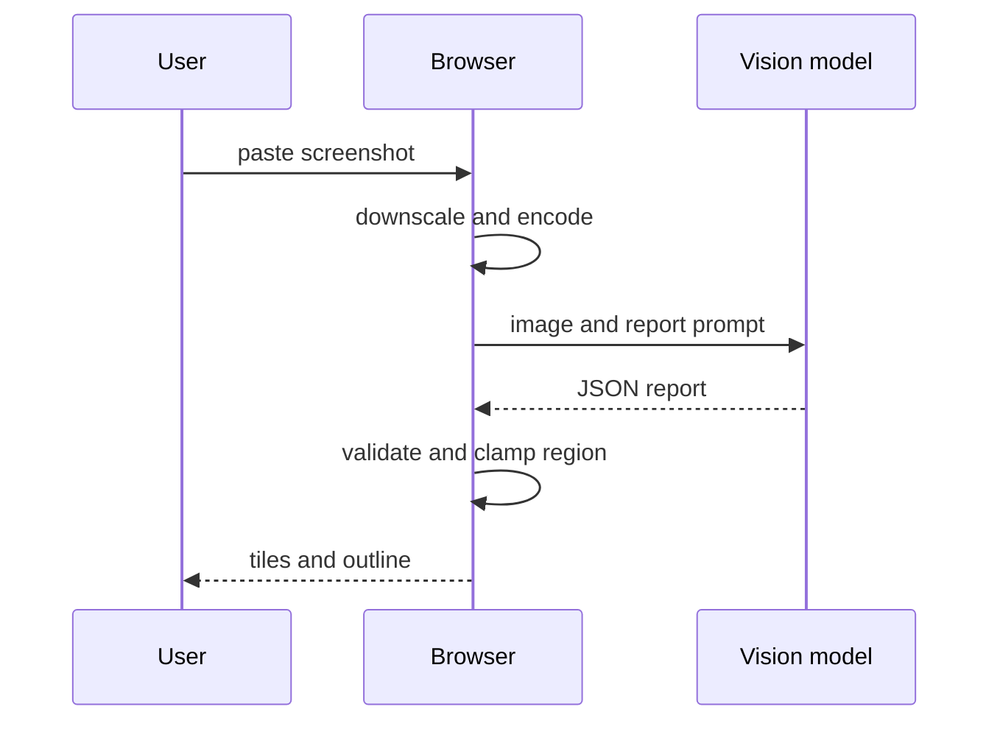

# Architecture

## Data flow

## Main sequence

## Modules

| Path | Responsibility |
|---|---|
| `lib/image.ts` | Downscaling and encoding |
| `lib/vision.ts` | Provider requests |
| `lib/report.ts` | Prompt, parsing and region validation |
| `lib/history.ts` | Local history |
| `lib/demo.ts` | Sample screenshot and report |
| `components/Tiles.tsx` | Result tiles |
| `lib/analytics.ts` | Analytics facade: typed event allowlist, queue, no-op without a key |
| `lib/posthog.ts` | The only import of the PostHog SDK and its privacy options; loaded on demand |
| `components/Analytics.tsx` | Manual `$pageview` on load and route changes; renders nothing without a key |
| `instrumentation-client.ts` | Loads the SDK on idle when a key exists |
| `next.config.ts` | `/ingest` rewrites to PostHog on Node hosts, registered only when `NEXT_PUBLIC_POSTHOG_KEY` is set; otherwise the route does not exist. The Pages export has none |

## Principles

- Pure logic lives in `lib/` and is tested without a browser; components stay thin.
- Network, storage and model replies are validated at the boundary.
- Secrets and user content stay in the browser.
- Analytics is off unless a build sets a key, and then sends only enums, numbers and booleans.

## Decisions

- [No server in the path](adr/0001-no-server-in-the-path.md)
- [Cookieless, content-free product analytics](adr/0002-cookieless-analytics.md)
